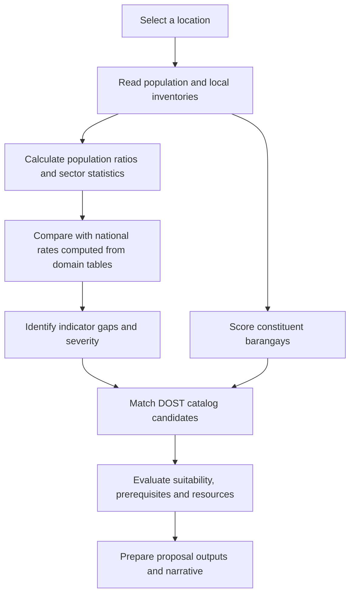

# Function tools and assessment calculations

This guide explains how KonektaDOST currently calculates its assessment results. It follows the PHP implementation, including its limitations, rather than assuming that every label in the interface is a verified real-world condition.

The numerical assessment uses database queries and deterministic formulas. A configured AI provider can write the executive narrative afterward; it does not calculate the core population ratios, national reference rates, or priority scores.

**All worked numbers below are fictional examples, not current database totals.**

## 1. Start here: cell sites per population

Suppose a municipality has **10 recorded cell-site rows** and **50,000 residents**.

```text
Cell sites per 100,000 people
  = recorded cell sites / population × 100,000
  = 10 / 50,000 × 100,000
  = 20
```

The result means **20 recorded cell sites for every 100,000 residents**, expressed on a common population scale. The actual inventory still contains 10 rows. Multiplying by 100,000 does not create additional sites or require the municipality to have 100,000 residents.

This lets differently sized municipalities be compared:

| Municipality | Recorded sites | Population | Sites per 100,000 |
| ------------ | -------------: | ---------: | ----------------: |
| A            |             10 |     50,000 |                20 |
| B            |             20 |    200,000 |                10 |

B has more recorded sites, while A has more recorded sites relative to its population.

The reciprocal for A is `50,000 / 10 = 5,000 residents per recorded site`. This is an inventory ratio, **not a measured tower capacity, subscriber count, signal radius, internet speed, or population coverage percentage**. Several inventory rows may represent equipment or operators at the same physical location; the basic rate does not deduplicate physical towers by coordinates.

The main implementation is [LocationAssessor.php](app/Support/Assessment/LocationAssessor.php). Sector tools also use the shared `ratePer()` helper in [SpatialMetrics.php](app/FunctionTools/Support/SpatialMetrics.php).

## 2. How the assessment flows



City/municipality assessments opened from the Service Area Map and Intelligence Map use [MunicipalityAssessmentData.php](app/Support/Assessment/MunicipalityAssessmentData.php). It supplies the profile, deterministic bundle, indicator results, barangay priorities, and Layer E results to the same React page.

The five visible workflow tabs cover Layers A–E. City pages first return a lightweight loading screen, then fetch their report asynchronously from the authenticated `/location/assess/data` endpoint. The sidebar stays usable while the report computes; failures offer a retry, and navigating away aborts the browser request. The endpoint revalidates the selection and returns private, non-stored responses.

Repeated deterministic tool results are reused only within that report computation and cleared when it finishes. Later reports read the current tables again. The interactive bundle skips Layer F because its proposal and executive outputs are not displayed in these tabs. Explicit `computeLocationBundle($location)` callers still receive the full action-plan bundle; the interactive page passes `includeActionPlan: false`.

A province or individual barangay opened from the Intelligence Map currently receives a scoped summary; it is not silently assessed as its parent municipality.

## 3. Which tools exist?

[FunctionToolRegistry.php](app/FunctionTools/FunctionToolRegistry.php) registers **29 tools**:

| Layer                          | Tools                                                                                                                                                                                                                          | Purpose                                                              |
| ------------------------------ | ------------------------------------------------------------------------------------------------------------------------------------------------------------------------------------------------------------------------------ | -------------------------------------------------------------------- |
| A — retrieval, 6               | `get_municipality_profile`, `get_population_statistics`, `get_available_datasets`, `get_local_assets`, `get_telecom_infrastructure`, `get_geographic_data_availability`                                                        | Retrieve facts and audit dataset availability.                       |
| B — analysis, 8                | `calculate_indicators`, `analyze_health_access`, `analyze_education_access`, `analyze_digital_connectivity`, `analyze_road_accessibility`, `analyze_agriculture`, `analyze_sti_laboratory_capacity`, `analyze_safety_and_drrm` | Calculate rates, distributions, distances, and sector summaries.     |
| C — prioritization, 3          | `detect_development_gaps`, `identify_underserved_areas`, `calculate_priority_scores`                                                                                                                                           | Identify recorded deficits and rank barangays.                       |
| D — catalog, 2                 | `search_dost_technologies`, `get_local_dost_projects`                                                                                                                                                                          | Retrieve technologies and location-matched project history.          |
| E — intervention evaluation, 5 | `match_dost_interventions`, `assess_intervention_suitability`, `assess_implementation_feasibility`, `identify_implementation_partners`, `estimate_intervention_requirements`                                                   | Screen candidates and evaluate implementation conditions.            |
| F — planning, 5                | `generate_intervention_plan`, `define_performance_indicators`, `estimate_intervention_outcomes`, `conduct_risk_assessment`, `generate_action_plan`                                                                             | Assemble proposed activities, targets, risks, and executive outputs. |

There is also an adapter, [AssessmentFunctionTools.php](app/Support/Assessment/AssessmentFunctionTools.php), used to assemble the assessment page bundle. Its `definitions()` currently lists the 19 Layer A–D tools, although its dispatcher also handles E/F tools. Some comments still say “14 tools”; use the actual registry and definitions when integrating a caller.

## 4. Where the inputs come from

| Input                     | Source                                                         | What is counted or read                                                                                                          |
| ------------------------- | -------------------------------------------------------------- | -------------------------------------------------------------------------------------------------------------------------------- |
| Population                | `population_figures`, `place_descriptions`, `collection_years` | Population for the requested geographic level and collection year.                                                               |
| Land area                 | Geography `area_km2` and boundary geometry                     | Stored area, or a documented profile fallback.                                                                                   |
| Health, education, safety | `facilities`                                                   | Recorded rows classified by `sector`, `facility_type`, or `level`.                                                               |
| Laboratories              | `laboratories`, `lab_services`                                 | Related laboratory records and distinct service/method combinations.                                                             |
| Connectivity              | `telecom_sites`                                                | Recorded sites and their technology lists, operators, and barangay assignments.                                                  |
| Roads, when present       | `roads`, `road_barangay`                                       | Road segments, recorded lengths, surfaces, and barangay links. These optional tables are queried without adding Eloquent models. |
| Agriculture               | `agriculture_count_estimates` and category/type tables         | Annual modeled quantities, areas, and financial fields.                                                                          |
| Intervention catalog      | `technologies`, `dost_techs`, `dost_projects`                  | Catalog text, status, project history, and available budget records.                                                             |

The numeric database ID, such as `municipality_id`, is different from a 10-digit `psg_code`. Map requests validate the selected location and its parent path through `GeographyExplorer` and `GeographicScope`.

Counting rules are not identical in every tool: some municipality queries additionally accept telecom `barangay_psgc` prefix matches, while scoped map summaries validate geographic membership. Inspect the query and returned scope when reconciling totals. A display name or map pin alone does not establish administrative membership.

### Population year and fallback rules

[GetPopulationStatisticsTool.php](app/FunctionTools/LayerA/GetPopulationStatisticsTool.php) builds population history. It prefers a positive direct LGU figure; if absent, it can sum matching child-code rows for a municipality/province and label the basis `barangay_sum`. If no active collection year is configured, that tool can fall back to its latest historical point.

The core `LocationAssessor` reads the location's active-year `populationFigure` relationship instead. Consequently, a profile can have a fallback population while a core indicator remains `no_data`. Check `current_basis`, `active_year`, the page's `populationYear`, and each indicator's status; do not assume every section has used an identical denominator.

## 5. The 11 core indicators

For population-normalized indicators:

```text
Rate = local recorded count / local population × scale
```

| Indicator key                  | Numerator                                                                        | Denominator / scale             | Current shortfall rule                                 |
| ------------------------------ | -------------------------------------------------------------------------------- | ------------------------------- | ------------------------------------------------------ |
| `population_density`           | Population                                                                       | Area in km²; no multiplier      | Above the reference is treated as population pressure. |
| `health_facilities_per_100k`   | Facility rows with `sector = health`                                             | Population; × 100,000           | Below reference.                                       |
| `hospitals_per_100k`           | Facility rows with `facility_type = hospital`                                    | Population; × 100,000           | Below reference.                                       |
| `pharmacies_per_100k`          | Facility rows with `facility_type = pharmacy`                                    | Population; × 100,000           | Below reference.                                       |
| `schools_per_100k`             | Facility rows with `sector = education`                                          | Population; × 100,000           | Below reference.                                       |
| `elementary_schools_per_100k`  | Facility rows with `level = elementary`                                          | Population; × 100,000           | Below reference.                                       |
| `laboratories_per_million`     | Related laboratory rows                                                          | Population; × 1,000,000         | Below reference.                                       |
| `laboratory_tests_per_million` | Distinct local service-name/description pairs, with legacy name/method fallbacks | Population; × 1,000,000         | Below reference.                                       |
| `telecom_sites_per_100k`       | Matching telecom-site rows                                                       | Population; × 100,000           | Below reference.                                       |
| `telecom_5g_share`             | Recorded sites supporting `5G` or `5G NR`                                        | All recorded local sites; × 100 | Below reference.                                       |
| `safety_facilities_per_100k`   | Facility rows with `sector = safety`                                             | Population; × 100,000           | Below reference.                                       |

Definitions and direction are in [IndicatorCatalog.php](app/Support/Assessment/IndicatorCatalog.php) and [Indicator.php](app/Support/Assessment/Indicator.php). These are the application's screening rules, not official minimum service standards.

### Worked examples

For 50,000 residents:

| Calculation                              | Example                   | Result              |
| ---------------------------------------- | ------------------------- | ------------------- |
| Health facilities per 100,000            | `15 / 50,000 × 100,000`   | 30                  |
| Hospitals per 100,000                    | `2 / 50,000 × 100,000`    | 4                   |
| Schools per 100,000                      | `12 / 50,000 × 100,000`   | 24                  |
| Laboratories per million                 | `2 / 50,000 × 1,000,000`  | 40                  |
| Distinct laboratory services per million | `30 / 50,000 × 1,000,000` | 600                 |
| Population density over 25 km²           | `50,000 / 25`             | 2,000 residents/km² |

A laboratory rate of 40 per million can therefore come from just **two actual laboratories** in a small municipality. Always retain the raw count beside the normalized rate.

Sector tools may also return rates **per 10,000**. For the cell-site example, `10 / 50,000 × 10,000 = 2`. It is the same inventory expressed on a different scale, not a contradictory result.

### 5G share uses sites, not population

```text
5G share = 5G-capable recorded sites / all recorded sites × 100
         = 6 / 10 × 100
         = 60%
```

This means 60% of the recorded sites support 5G. It does **not** mean 60% of residents or land area have a 5G signal. A site listing both 4G and 5G is still one site in the total.

Although this percentage is not population-normalized, the current core assessor requires a positive population before evaluating any indicator, including 5G share. The raw telecom/sector tools can still expose site-based statistics when a population ratio is unavailable.

### Rounding

Core population rates and `SpatialMetrics::ratePer()` round to three decimals. Core population density rounds to two decimals; 5G share rounds to one decimal. The core percentage benchmark gap is calculated from those values without an additional explicit rounding step; the UI may format it for display.

## 6. How the national reference is computed

`LocationAssessor::computeAllDynamicBenchmarks()` reads the current domain tables. It does not fetch a static `Benchmark` model or use a fixed official tower-to-population requirement.

```text
National cell-site reference
  = all recorded telecom-site rows / national population × 100,000

Example: 12,000 sites / 100,000,000 residents × 100,000
  = 12 sites per 100,000 residents
```

The national population is the sum of non-null active-year figures linked to the latest-release City/Mun place descriptions. Barangay and province populations are not added again to that denominator.

The reference is a **ratio of totals**, not the arithmetic average of municipal rates. It changes when source inventories, population data, or the active year change.

| Reference               | Current aggregation                                                                                    |
| ----------------------- | ------------------------------------------------------------------------------------------------------ |
| Facility rates          | Corresponding classifications across `facilities`, divided by national population.                     |
| Population density      | National population divided by the sum of positive stored municipality `area_km2` values.              |
| Laboratory rate         | Laboratory rows with `is_outside_philippines = false` or null, divided by national population.         |
| Laboratory-service rate | All `lab_services` rows, divided by national population.                                               |
| Cell-site rate          | All `telecom_sites` rows, divided by national population.                                              |
| 5G share                | National recorded sites whose technology list contains `5G` or `5G NR`, divided by all recorded sites. |

The local laboratory-service numerator deduplicates name/method combinations, while the national service reference currently counts rows. These are not identical deduplication policies. National facility/site totals also do not require every row to have a usable local geographic assignment. Import completeness and mapping quality can therefore affect comparisons.

## 7. Comparing the local rate with the reference

```text
Percentage gap = (local rate - reference rate) / reference rate × 100
```

Using the reference of 12 sites per 100,000:

| Local rate | Calculation            |     Gap | Meaning under the current rule                            |
| ---------: | ---------------------- | ------: | --------------------------------------------------------- |
|         20 | `(20 - 12) / 12 × 100` | +66.67% | Above the recorded national rate.                         |
|          8 | `(8 - 12) / 12 × 100`  | −33.33% | Below the recorded national rate; flagged as a shortfall. |
|         12 | `(12 - 12) / 12 × 100` |      0% | Equal to the reference.                                   |

For ordinary facility/site indicators, **below** the reference is a shortfall. For density, **above** the reference is treated as pressure on services. A high density is not independently proof of deprivation.

If the reference is missing, the result is `no_benchmark`. If a reference exists but is zero, the percentage gap is null to avoid dividing by zero. `median` is currently null in core results; a median of municipal rates is not calculated here.

The comparison does not itself calculate a required construction count or prove that additional towers, hospitals, or schools should be built.

## 8. Gap severity: 0–100

[DetectDevelopmentGapsTool.php](app/FunctionTools/LayerC/DetectDevelopmentGapsTool.php) processes indicators flagged as shortfalls:

```text
Magnitude = min(100, absolute percentage gap)
Confidence multiplier = 1.00 for high confidence; 0.65 for low confidence
Severity = round(Magnitude × Confidence multiplier, 1)
```

For the cell-site shortfall of 33.33%, high-confidence severity is **33.3**. The same percentage gap with low confidence produces **21.7**. This is a rule-based severity score, not a probability.

| Severity       | Label      |
| -------------- | ---------- |
| 75–100         | `critical` |
| 50 to below 75 | `high`     |
| 25 to below 50 | `moderate` |
| Below 25       | `low`      |

Low-confidence shortfalls can still enter the gap list with a discounted severity. A missing percentage gap falls back to zero magnitude in the current implementation; inspect the underlying value/reference rather than treating that zero as evidence of no concern.

## 9. Barangay priority scoring: a separate calculation

An indicator gap compares a rate with a national reference. A barangay priority score combines several local components. They are different outputs.

[CalculatePriorityScoresTool.php](app/FunctionTools/LayerC/CalculatePriorityScoresTool.php) uses these default weights, totaling 100:

| Component                | Weight | Contribution                                                                                                         |
| ------------------------ | -----: | -------------------------------------------------------------------------------------------------------------------- |
| Population need          |     25 | `(0.7 × population / maximum barangay population + 0.3 × density / maximum barangay density) × weight`               |
| Health access gap        |     20 | Full weight for zero recorded health facilities; 30% of weight for one; zero for two or more.                        |
| Education access gap     |     15 | Full weight for zero recorded schools; 30% of weight for one; zero for two or more.                                  |
| Road accessibility gap   |     15 | Full active weight when no linked positive road length is recorded; otherwise zero.                                  |
| Digital connectivity gap |     10 | Full active weight when no cell site is recorded for the barangay; otherwise zero.                                   |
| Safety/DRRM gap          |     10 | Full weight when no safety facility is recorded; otherwise zero.                                                     |
| Geographic isolation     |      5 | `min(weight, distance_km / 6 × weight)`; uses nearest recorded facility, then municipal-center distance as fallback. |

Components are rounded as implemented and summed; the final score is rounded to one decimal. Population/density normalization uses maxima among barangays in the selected municipality, not national maxima. Distance is straight-line Haversine distance, not driving distance.

### Example priority score

Assume all components are active. A barangay has half the maximum population, one-quarter the maximum density, no health facility, one school, no linked road length, no cell site, one safety facility, and a nearest-facility distance of 3 km:

```text
Population = (0.7 × 0.50 + 0.3 × 0.25) × 25 = 10.63
Health     = 20
Education  = 15 × 0.30 = 4.50
Roads      = 15
Digital    = 10
Safety     = 0
Isolation  = min(5, 3 / 6 × 5) = 2.50
Total      = 62.6 / 100 after final rounding
```

| Composite score | `priority_tier`   |
| --------------- | ----------------- |
| 70 and above    | `tier_1_urgent`   |
| 50 to below 70  | `tier_2_high`     |
| 30 to below 50  | `tier_3_moderate` |
| Below 30        | `tier_4_low`      |

### Dataset availability and weight redistribution

If the road dataset status is `empty`, its weight becomes zero. The same check applies to telecom data. Remaining weights are normalized:

```text
Normalized weight = active raw weight / sum of active raw weights × 100
```

For example, excluding only roads leaves a total raw weight of 85. Population becomes `25 / 85 × 100 = 29.41`, and health becomes `20 / 85 × 100 = 23.53`. Two-decimal weight rounding can make the total slightly different from 100.

Current limitations matter when interpreting this score:

- The availability check explicitly excludes `empty`; it does not separately exclude an `unavailable` status. Inspect `dataset_audit` and `active_weights` rather than assuming all missing datasets were removed.
- Missing population produces a null final score. Missing density contributes zero to its subcomponent; missing both distance measures also contributes zero isolation points.
- Missing facility tables/counts can appear as zero recorded facilities in this scoring path. That is a data-completeness issue, not proof of absence.
- Read `score_components.normalized_components` to explain the composite. Older compatibility fields such as `population_score` and `deficit_score` are not the components summed into the new composite.
- The page's `focus` filters core indicators, but the current `PrioritizationService::calculatePriorityScores()` adapter does not pass that focus into a different weight configuration.

### Why a barangay can say “covered” and still have a high score

The separate `priority_level` compatibility label uses a simpler rule: missing population is `unmeasured`; zero combined health/education/safety/site records is `high` when population is at least the barangay average, otherwise `moderate`; any such recorded resource yields `covered`.

That label is not the same as `priority_tier`, and “covered” does not establish geographic signal or service coverage. The separate `identify_underserved_areas` tool also evaluates unmet domains; its output should not be substituted for the composite score.

## 10. Other sector computations

| Measure                                  | Formula or method                                                                                           | Interpretation                                                                         |
| ---------------------------------------- | ----------------------------------------------------------------------------------------------------------- | -------------------------------------------------------------------------------------- |
| Population change                        | `current population - baseline population`                                                                  | Absolute increase/decrease.                                                            |
| Population growth                        | `(current - baseline) / baseline × 100`                                                                     | Percentage change over the whole period.                                               |
| Annual growth, CAGR                      | `((current / baseline)^(1 / years elapsed) - 1) × 100`                                                      | Compounded annual percentage change.                                                   |
| Barangay population share                | `barangay population / municipal population × 100`, with the scoring tool's documented fallback denominator | Share of the chosen population total.                                                  |
| Recorded barangay facility/site coverage | `barangays with at least one relevant recorded resource / total barangays × 100`                            | Inventory presence, not household access or radio coverage.                            |
| Road length                              | `sum(recorded length_m) / 1,000`                                                                            | Recorded kilometres; sector total rounds to two decimals.                              |
| Road density                             | `recorded road kilometres / area_km2`                                                                       | km of recorded road per km²; rounds to three decimals.                                 |
| Paved share in feasibility               | `segments classified concrete/asphalt/paved / all recorded segments × 100`                                  | Segment-count share, not length-weighted share.                                        |
| Agricultural area                        | `sum(area_sqm) / 10,000`                                                                                    | Hectares from recorded modeled areas.                                                  |
| Agriculture finances                     | Sum the stored annual revenue, operating-cost, and net fields separately for the latest local `model_year`  | The analysis aggregates stored estimates; it does not newly estimate yields or prices. |
| Agriculture net margin                   | `summed net / summed revenue × 100`, when revenue is positive                                               | Can be negative; not computed when required totals are missing.                        |

Example growth: 40,000 residents rising to 50,000 over four years means `+10,000`, `+25%` overall, and approximately `5.74%` annual CAGR. The population tool chooses the latest earlier positive historical point as its baseline; it is not permanently fixed to 2020.

The profile's area fallback order is positive stored `area_km2`, then a positive summed barangay area for municipalities, then geometry-derived area. The core indicator assessor directly reads the location's stored area, while scoped map summaries calculate polygon area. These different area bases can produce different density values.

Nearest-facility searches use the location center and Haversine distances. The helper searches a bounded candidate window and limits facility candidates to 500. A nearest result means nearest among the searched recorded candidates, not a guaranteed shortest route or exhaustive travel-time analysis.

Roads and agriculture have descriptive Layer B outputs even where no corresponding scored indicator is registered in the 11-indicator catalog. Descriptive statistics do not automatically become benchmarked gaps.

## 11. How intervention scores are produced

### Catalog relevance

[MatchDostInterventionsTool.php](app/FunctionTools/LayerE/MatchDostInterventionsTool.php) uses sector/category matching, keyword overlap, and selected local context. It is a deterministic text-and-rule screen, not an AI similarity model.

| Catalog source | Current score components                                                                                                                                                  |
| -------------- | ------------------------------------------------------------------------------------------------------------------------------------------------------------------------- |
| `Technology`   | Base 20; sector/category match +35; keyword bonus `min(25, matches × 8)`; qualifying local education/health/agriculture context +15; active/verified status +10; cap 100. |
| `DostTech`     | Base 20; sector match +35; keyword bonus `min(25, matches × 8)`; qualifying agriculture context +15; active status +10; cap 100.                                          |
| `DostProject`  | Base 15; sector match +30; keyword bonus `min(20, matches × 6)`; cap 95.                                                                                                  |

Candidates require a score of at least 40 to enter the matched list. A score of 80 is a relevance score, not an 80% probability of success. A matching historical project is evidence of related activity, not a current grant offer.

### Suitability

[AssessInterventionSuitabilityTool.php](app/FunctionTools/LayerE/AssessInterventionSuitabilityTool.php) combines rule-based 0–100 dimension scores:

```text
Suitability = round(
    need relevance × 0.30
  + beneficiary reach × 0.20
  + resource readiness × 0.15
  + infrastructure readiness × 0.20
  + institutional readiness × 0.15
)
```

The labels are `highly_suitable` at 80+, `suitable` at 65+, `moderately_suitable` at 45+, and `low_suitability` below 45. Read the returned enablers, constraints, and dimension scores; readiness is inferred from rules and available records, not established by a site inspection.

### Feasibility, costs, and projected outcomes

- [AssessImplementationFeasibilityTool.php](app/FunctionTools/LayerE/AssessImplementationFeasibilityTool.php) checks catalog status, road records, telecom records, potential host facilities, and income classification. Blockers produce `not_yet_feasible`; conditions produce `conditionally_feasible`; otherwise it returns `feasible`. Its normal confidence values of 85/80/90 are assigned rule values, not statistical confidence intervals. The current paved-road prerequisite uses a 40% segment-count threshold.
- [EstimateInterventionRequirementsTool.php](app/FunctionTools/LayerE/EstimateInterventionRequirementsTool.php) uses equipment/personnel templates and up to 20 matching historical project budget records. It returns minimum, middle sorted value, and maximum of positive parsed budgets; for an even sample, that “median” is the upper middle value, not the mean of the two middle values. No matching budget means `financial_status = pending`, not a fabricated cost estimate.
- [EstimateInterventionOutcomesTool.php](app/FunctionTools/LayerF/EstimateInterventionOutcomesTool.php) includes preset planning assumptions. One beneficiary target is `round(population × 0.12)` and uses a population fallback of 25,000 when its direct figure is missing. Other targets include fixed training-cohort and barangay assumptions. These are projected scenarios, not observed outcomes or independently validated demographic forecasts.
- [ConductRiskAssessmentTool.php](app/FunctionTools/LayerF/ConductRiskAssessmentTool.php) includes fixed heuristics. For example, fewer than two recorded sites raises its telecom-risk likelihood; missing road records use a 50% unpaved assumption. Those assumptions must not be reported as measured infrastructure conditions.

## 12. Missing data, zeros, and confidence

| Output                  | Meaning                                                                                               |
| ----------------------- | ----------------------------------------------------------------------------------------------------- |
| `status = available`    | A value and reference were computed; source confidence still matters.                                 |
| `status = no_data`      | The indicator lacks a usable measurement, population denominator, or required input.                  |
| `status = no_benchmark` | A local value was computed, but no national reference can be computed.                                |
| `confidence = low`      | The implemented checks found a source-completeness concern.                                           |
| Recorded zero           | No matching rows/value were recorded under that query; it is not automatically proof that none exist. |

The core confidence checks mark a zero volunteer-sourced facility rate as low confidence. Elementary-school confidence is also lowered when more than 20% of recorded education facilities have unknown, blank, or null level tags. A “high” confidence value only means these implemented checks did not lower it; it does not certify a complete inventory.

There are current differences between paths: a nonempty site's missing technology list remains in the core 5G-share denominator, while `SelectionAssessment` treats unknown site technologies as an unavailable 5G comparison. Also, core facility counts can default to zero where a more defensive scoped summary explicitly reports an unavailable classification. Check the status and reason from the actual output you are citing.

Map marker clusters show counts of visible geocoded inventory rows. They are not per-population rates. Turning Local Facilities or Cell Sites off only hides those pins; it does not remove the records from the assessment.

## 13. Executive outputs and narrative limits

`generate_action_plan` assembles priority areas, critical needs, recommended interventions, investment/resource priorities, and expected outcomes/performance. Its status is a proposal pending human validation and approval.

[AiNarrativeService.php](app/Support/Ai/AiNarrativeService.php) uses templates when no Gemini key is configured. With a configured key, it can send the assembled context to Gemini for narrative synthesis and fall back to templates on failure. The formula-based results should remain the evidence for numerical claims.

Some Layer F aggregation currently expects older field names: for example, `priority_scores`/`composite_priority_score` instead of the priority tool's `barangays`/`composite_score`, and `critical_severity_count` instead of `critical_gaps_count`. This can leave executive summaries empty or zero despite populated detailed tool outputs. Verify the detailed outputs before citing an executive total. This guide documents that behavior; it does not change the formulas or fix those mappings.

## 14. Run and inspect a tool

From the project root, open Laravel Tinker:

```powershell
php artisan tinker
```

Then run PHP commands inside Tinker. Replace `959` with the numeric ID of your selected municipality:

```php
$registry = app(\App\FunctionTools\FunctionToolRegistry::class);
$municipalityId = 959;

// Inspect tool schemas without running a full assessment.
$registry->definitions('B');

// Inspect the raw telecom inventory and its calculation separately.
$inventory = $registry->execute('get_telecom_infrastructure', ['municipality_id' => $municipalityId]);
$digital = $registry->execute('analyze_digital_connectivity', ['municipality_id' => $municipalityId]);
$digital['rates_per_100k'];

// Inspect gaps and the exact components behind each priority score.
$gaps = $registry->execute('detect_development_gaps', ['municipality_id' => $municipalityId]);
$priorities = $registry->execute('calculate_priority_scores', ['municipality_id' => $municipalityId]);
$priorities['active_weights'];
$priorities['barangays'][0]['score_components']['normalized_components'];
```

Use individual tools first when investigating a formula. Full municipality bundles run many nested computations; `generate_action_plan` can also invoke the configured narrative provider. Layer C ranking and the E/F planning flow are intended for a municipality and its constituent barangays; do not pass a province ID as `municipality_id`.

## 15. Files to read when a result needs explaining

| Question                                                          | Source                                                                                                                                                                                             |
| ----------------------------------------------------------------- | -------------------------------------------------------------------------------------------------------------------------------------------------------------------------------------------------- |
| What does an indicator count, and which direction is a shortfall? | [IndicatorCatalog.php](app/Support/Assessment/IndicatorCatalog.php)                                                                                                                                |
| How are rates, references, gaps, and confidence calculated?       | [LocationAssessor.php](app/Support/Assessment/LocationAssessor.php), [IndicatorResult.php](app/Support/Assessment/IndicatorResult.php)                                                             |
| Which population/year/basis did the profile use?                  | [GetPopulationStatisticsTool.php](app/FunctionTools/LayerA/GetPopulationStatisticsTool.php)                                                                                                        |
| Which recorded sites and technologies were counted?               | [GetTelecomInfrastructureTool.php](app/FunctionTools/LayerA/GetTelecomInfrastructureTool.php), [AnalyzeDigitalConnectivityTool.php](app/FunctionTools/LayerB/AnalyzeDigitalConnectivityTool.php)   |
| Why is a gap severe or a barangay prioritized?                    | [DetectDevelopmentGapsTool.php](app/FunctionTools/LayerC/DetectDevelopmentGapsTool.php), [CalculatePriorityScoresTool.php](app/FunctionTools/LayerC/CalculatePriorityScoresTool.php)               |
| Why do map totals or selected-area results differ?                | [GeographicScope.php](app/Support/Map/GeographicScope.php), [SelectionAssessment.php](app/Support/Map/SelectionAssessment.php), [MapAssessmentReport.php](app/Support/Map/MapAssessmentReport.php) |
| How is the current assessment page populated?                     | [MunicipalityAssessmentData.php](app/Support/Assessment/MunicipalityAssessmentData.php), [AssessmentFunctionTools.php](app/Support/Assessment/AssessmentFunctionTools.php)                         |

When presenting a result, include the **raw count, population and year, calculation scale, computed value, reference, gap, status, and source limitations**. For example: “10 recorded sites, 50,000 residents, 20 sites per 100,000 residents; above the dataset-derived reference of 12. This does not establish signal coverage.”
